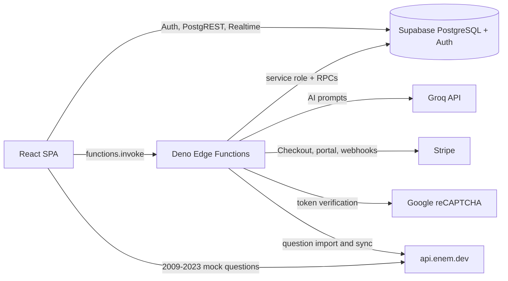

<div align="center">

# Aprendify 📚

**ENEM preparation platform with study schedules, past-exam questions, mock exams, TRI estimates, and AI-assisted essay feedback.**

[](https://react.dev/)
[](https://www.typescriptlang.org/)
[](https://vite.dev/)
[](https://tailwindcss.com/)
[](https://supabase.com/)
[](LICENSE)

<br />

<p align="center">
  <a href="#overview"><b>Overview</b></a> •
  <a href="#stack"><b>Stack</b></a> •
  <a href="#architecture"><b>Architecture</b></a> •
  <a href="#quick-start"><b>Quick Start</b></a> •
  <a href="#configuration"><b>Configuration</b></a> •
  <a href="#features"><b>Features</b></a> •
  <a href="#routes"><b>Routes</b></a> •
  <a href="#testing"><b>Testing</b></a> •
  <a href="#deployment"><b>Deployment</b></a> •
  <a href="#known-limitations-mvp-trade-offs"><b>Limitations</b></a> •
  <a href="#governance"><b>Governance</b></a>
</p>

</div>

---

> **Public product site:** [www.aprendify.cloud](https://www.aprendify.cloud) ·
> **Application host:** [app.aprendify.cloud](https://app.aprendify.cloud) ·
> **Repository:** [felipevenas/aprendify](https://github.com/felipevenas/aprendify)

## Overview

Aprendify is a web application for Brazilian students preparing for the **ENEM** (*Exame Nacional do Ensino Médio*). It combines the daily study routine and the exam practice loop in one place: plan the week, answer real past-exam questions, take timed mock exams, review mistakes, write essays with rubric-based AI feedback, and track consistency through streaks, rankings, and weekly challenges.

The product is built around four outcomes:

1. **Plan** — a personalized weekly schedule, tasks, notes, and an AI-generated study plan for Premium users.
2. **Practice** — a question bank with filters, question-level AI explanations, mock exams, a TRI (Item Response Theory) score estimate, and an error notebook.
3. **Write** — essay topics generated by AI, correction against the five official ENEM competencies, and a private sociocultural repertoire library.
4. **Stay consistent** — streaks, achievements, leaderboard, weekly challenges, study heatmap, Pomodoro timer, and a social hub with friends and focus challenges.

This repository owns the **React single-page application** and the **Supabase backend configuration**: SQL migrations, Row Level Security (RLS), RPCs, and Deno Edge Functions. The public marketing site at `www.aprendify.cloud` is deployed separately; the application runs at `app.aprendify.cloud` (see [`docs/DOMAIN-MIGRATION.md`](docs/DOMAIN-MIGRATION.md)).

### What this repository owns

| Area | Responsibility |
|---|---|
| Web client | Routing, authentication screens, dashboards, feature modules, and design system |
| Application state | Supabase session, TanStack Query server state, Realtime invalidation, premium/entitlement context |
| Database | 72 timestamped migrations, schema evolution, RLS policies, triggers, RPCs, and quota enforcement |
| Edge Functions | 24 Deno functions for authentication, AI assistance, question import, Stripe billing, and reCAPTCHA verification |
| Operational config | Vercel build/rewrite/security headers and Supabase function runtime settings |

### Product language

The **product UI is Brazilian Portuguese**, because it serves ENEM candidates. Repository documentation, governance, issue/PR templates, and commit messages are **English**.

## Stack

Versions below are the ranges declared in [`package.json`](package.json); install output is locked by `package-lock.json`.

| Layer | Technology | Verified version / role |
|---|---|---|
| UI runtime | React | `^18.3.1` |
| Language | TypeScript | `^5.8.3` |
| Build tool | Vite | `^7.3.6` with `@vitejs/plugin-react-swc` |
| Styling | Tailwind CSS | `^3.4.17`, `tailwindcss-animate`, CSS variables |
| Component system | shadcn/ui + Radix UI | shadcn `default` style, slate base, 25+ Radix primitives |
| Backend platform | Supabase | `@supabase/supabase-js ^2.84.0` — Auth, PostgreSQL, Realtime, Edge Functions |
| Server state | TanStack Query | `^5.83.0` |
| Routing | React Router | `^7.18.3`, lazy route modules |
| Forms and validation | React Hook Form + Zod | `^7.61.1` + `^3.25.76` |
| Motion | Framer Motion | `^12.23.24` |
| Charts | Recharts | `^2.15.4` |
| PDF export | jsPDF | `^4.0.0` |
| Icons | lucide-react | `^0.462.0` |
| AI provider | Groq | OpenAI-compatible chat completions, called only from Edge Functions |
| Payments | Stripe | Stripe SDK `18.5.0` inside Edge Functions |
| Signup protection | Google reCAPTCHA v2 | Site key in the client, secret in Edge Functions |
| Linting | ESLint 9 + typescript-eslint 8 | `eslint.config.js` |
| Tests | Node.js test runner | `node --test`, no Vitest/Jest dependency |
| Runtime for Edge Functions | Deno | Supabase Edge Functions |

## Architecture

Aprendify is a **feature-first React SPA backed by Supabase**. The client talks directly to Supabase Auth, PostgREST, Storage, and Realtime using the public anon key; privileged work runs in Edge Functions with the service-role key. RLS is the primary authorization boundary for user-owned data, and Edge Functions enforce authentication, admin roles, quotas, and rate limits for operations that must not be trusted to the client.

```text
aprendify/
├── .github/                    issue and pull request templates
├── docs/                       operational and migration notes
├── public/                     favicon, placeholder, robots.txt
├── src/
│   ├── components/
│   │   ├── ui/                 shadcn/ui primitives and shared UI
│   │   ├── dashboard/          dashboard widgets (Pomodoro, heatmap, plan)
│   │   ├── schedule/           calendar, grid, adherence views
│   │   ├── simulados/          exam runner, timer, TRI display
│   │   └── ...                 shared layout and premium gates
│   ├── contexts/               app-wide providers (Streak, Premium, Pomodoro, help tours)
│   ├── features/               domain modules (see table below)
│   ├── hooks/                  shared hooks (premium, streak, question bank, sound)
│   ├── integrations/supabase/  typed Supabase client and generated Database types
│   ├── lib/                    route loaders, formatters, subjects, TRI, PDF helpers
│   ├── pages/                  thin route entry points re-exporting feature pages
│   ├── providers/              theme provider
│   ├── shared/                 shared layout, navigation, and formatters
│   ├── App.tsx                 providers, QueryClient, router, code splitting
│   ├── main.tsx                application bootstrap
│   └── index.css               design tokens and global styles
├── supabase/
│   ├── functions/              24 Deno Edge Functions + `_shared/`
│   ├── migrations/             72 timestamped SQL migrations
│   └── config.toml             function JWT verification settings
├── .env.example                public frontend variables
├── vercel.json                 build, SPA rewrites, and security headers
└── vite.config.ts              port, aliases, vendor chunk splitting
```

### Feature modules

| Module | Responsibility |
|---|---|
| `admin` | Question import/sync, manual questions, AI classification, users, creator coupons, notifications, feedback |
| `auth` | Login, signup, Google OAuth, password reset, MFA, validation, redirects |
| `creator` | Creator dashboard, coupons, Pix key |
| `dashboard` | Daily goal, study plan, stats, heatmap, leaderboard, weekly challenges |
| `essays` | Essay editor, history, rubric feedback, annotation, intervention checklist |
| `feedback` | User feedback tickets |
| `flashcards` | Spaced-review-style cards with a free cap |
| `friends` | Friends, presence, direct messages, focus challenges |
| `gamification` | Streaks, achievements, leaderboard, weekly challenges, Pomodoro |
| `legal` | Terms of service and privacy policy |
| `notes` | Personal study notes |
| `onboarding` | First-access profile gate |
| `questions` | ENEM question bank, filters, practice, explanations, difficulty |
| `repertoires` | Private sociocultural repertoire library with AI generation |
| `review-errors` | Error notebook and review statistics |
| `schedule` | Weekly schedule, monthly calendar, AI generation, adherence |
| `settings` | Profile, statistics, subscription, security, preferences, admin entry |
| `simulados` | Mock exam creation, execution, results, TRI, PDF, AI analysis |
| `statistics` | Performance comparisons and AI study suggestions |
| `subscription` | Plans, Stripe checkout, trial, customer portal, premium locks |
| `tasks` | Task list |
| `tri-calculator` | ENEM/SISU score simulator |

### Request and data flow



### Architectural decisions

- **RLS first.** User-facing tables are protected by policies; the free question cap, essay quota, flashcard cap, and Premium-only mock exams are enforced in the database, not only in the UI.
- **Service role stays server-side.** `SUPABASE_SERVICE_ROLE_KEY` is used only inside Edge Functions. The browser receives `VITE_SUPABASE_URL` and a publishable/anon key.
- **Edge Functions own privileged operations.** AI calls, Stripe checkout/portal, webhook handling, question import, user administration, and creator coupons never expose provider secrets to the client.
- **Fail closed on quotas.** Rate limiting uses the `consume_rate_limit`/`consume_social_rate_limit` RPCs and returns `429` with `Retry-After`; if the quota service is unavailable, AI and billing operations return `503` instead of proceeding unmetered.
- **Idempotent billing.** Stripe webhook events are claimed in `stripe_webhook_events` before processing, and subscription projections are recorded through RPCs.
- **Route-level code splitting.** Light routes (`/auth`, legal pages, plans, offer) load without the authenticated shell; `AppLayout` lazy-loads provider-heavy application routes. Vite splits vendor code into React, UI, charts, motion, and Supabase chunks.
- **Server state is not duplicated.** TanStack Query owns fetching/caching, and Supabase Realtime channels invalidate lists and counters when rows change.
- **Typed database contract.** `src/integrations/supabase/types.ts` is the generated `Database` type used by the Supabase client. Regenerate it after schema changes instead of editing it by hand.

### Database domains

| Domain | Main tables |
|---|---|
| Identity and access | `profiles`, `user_roles`, `free_trial_entitlements` |
| Billing | `subscriptions`, `subscription_history`, `stripe_webhook_events`, `creator_coupons`, `coupon_redemptions`, `creator_coupon_history`, `essay_addon_credit_ledger` |
| Study planning | `subjects`, `schedule_items`, `schedule_generations`, `tasks`, `notes` |
| Questions and practice | `enem_questions`, `questions`, `question_attempts`, `flashcards`, `simulados`, `simulado_answers`, `simulado_results` |
| Writing | `essays`, `essay_quota_counters`, `repertorios_socioculturais` |
| Gamification | `user_streaks`, `achievements`, `leaderboard_stats`, `weekly_challenges`, `user_challenge_progress` |
| Social | `friendships`, `friend_messages`, `user_presence`, `social_notifications`, `focus_challenges`, `social_rate_limits`, `notification_reads`, `system_notifications` |
| Operations | `ai_rate_limits`, `feedback_tickets` |

## Quick Start

### Prerequisites

- **Node.js 22 or newer** — the `test:unit` script relies on `--experimental-strip-types`; this repository was validated with Node 24.
- **npm 10 or newer** — `package-lock.json` is the committed lockfile.
- **Git**.
- A **Supabase project** with the migrations and Edge Functions deployed. Without it, the app boots but authentication and data operations fail.
- Optional: **Supabase CLI** and **Docker** for a local database and functions.

> The application UI is Brazilian Portuguese. This is intentional and does not affect the English documentation standard.

### 1. Clone and install

```powershell
git clone https://github.com/felipevenas/aprendify.git
cd aprendify
npm install
Copy-Item .env.example .env.local
```

On macOS/Linux, use `cp .env.example .env.local`. The project sets `legacy-peer-deps=true` in `.npmrc`; Vercel uses the same flag.

### 2. Configure the public environment

Fill `.env.local` with the Supabase project URL and publishable/anon key:

```env
VITE_SUPABASE_URL=https://your-project-ref.supabase.co
VITE_SUPABASE_PUBLISHABLE_KEY=your-publishable-key
```

Only `VITE_*` variables reach the browser bundle. Never put a service-role key, Stripe secret, or AI provider key there.

### 3. Start the development server

```powershell
npm run dev
```

Vite serves the app at **http://localhost:8080** (configured in [`vite.config.ts`](vite.config.ts)). Edge Functions that restrict CORS allow `http://localhost:8080` and `http://127.0.0.1:8080`.

### 4. Prepare the Supabase backend (optional for UI work)

For a dedicated development or staging project:

```powershell
npx supabase login
npx supabase link --project-ref <project-ref>
npx supabase db push
npx supabase functions deploy
npx supabase secrets set --env-file supabase/.env
```

For a fully local stack, run `npx supabase start` (Docker required) and point `VITE_SUPABASE_URL`/`VITE_SUPABASE_PUBLISHABLE_KEY` to the local API values printed by the CLI.

Edge Function secrets are listed in [Configuration](#configuration). Do not deploy these commands against production from this guide.

### 5. Run the quality gates

```powershell
npm run lint
npm run typecheck
npm run test:unit
npm test
npm run build
```

`npm run build` runs Vite only; `npm run typecheck` is a separate gate.

## Configuration

### Frontend variables — `.env.local`

Vite exposes only variables prefixed with `VITE_`. Everything in this table is **public** and ends up in the browser bundle.

| Variable | Required | Default / example | Description |
|---|---|---|---|
| `VITE_SUPABASE_URL` | **Yes** | `https://your-project-ref.supabase.co` | Supabase project URL used by Auth, PostgREST, Realtime, and direct Edge Function calls. |
| `VITE_SUPABASE_PUBLISHABLE_KEY` | **Yes** | `your-publishable-key` | Supabase publishable/anon key. Safe to ship to the browser; authorization is enforced by RLS and Edge Functions. |

No other `VITE_*` variables are read by the codebase. The reCAPTCHA v2 **site key** is currently a public constant in `src/features/auth/pages/AuthPage.tsx`; its secret belongs to the Edge Function environment.

### Edge Function secrets

Configure these with `npx supabase secrets set` for the linked project. They are never read by the Vite client.

| Variable | Required | Default / example | Description |
|---|---|---|---|
| `SUPABASE_URL` | **Yes** | injected by Supabase | Project URL available inside Edge Functions. |
| `SUPABASE_ANON_KEY` | **Yes** | injected by Supabase | Anon key used to build user-scoped clients. |
| `SUPABASE_SERVICE_ROLE_KEY` | **Yes** | injected by Supabase | Service-role key for privileged queries and RPCs. Never expose it to the client. |
| `GROQ_API_KEY` | For AI features | — | Groq API key used by essay correction, schedule generation, explanations, simulado analysis, and repertoire generation. |
| `STRIPE_SECRET_KEY` | For billing | — | Stripe secret key used by checkout, trial, portal, coupon, and webhook functions. |
| `STRIPE_WEBHOOK_SECRET` | For billing webhooks | — | Signing secret used to verify Stripe webhook signatures. |
| `STRIPE_PRICE_STARTER` | For billing | — | Comma-separated allowed Stripe price IDs for the monthly plan. |
| `STRIPE_PRICE_ANNUAL` | For billing | — | Comma-separated allowed Stripe price IDs for the annual plan. |
| `STRIPE_PRICE_ORDER_BUMP_REDACAO` | For the essay add-on | — | Comma-separated allowed price IDs for the Redação Combo order bump. |
| `STRIPE_ORDER_BUMP_CREDITS` | For the essay add-on | — | Positive integer number of essay credits granted when the add-on is purchased. |
| `RECAPTCHA_SECRET_KEY` | For signup protection | — | Google reCAPTCHA v2 secret used by `verify-recaptcha`. |

### Billing and trial behavior

- The plan catalog is defined in `src/features/subscription/catalog.ts`: monthly **Prática** at **R$ 9.90/month** and annual **Completo** at **R$ 95.04/year** (20% discount, equivalent to R$ 7.92/month).
- New accounts created after the trial migration are eligible for a **72-hour Completo trial**. Activation is server-owned and requires a confirmed e-mail; the client opens Stripe Checkout with `trial_period_days: 3` and `payment_method_collection: "if_required"`.
- Stripe is configured to cancel the subscription at trial end when no payment method is present (`trial_settings.end_behavior.missing_payment_method: "cancel"`). Do not describe the trial as card-free; the exact Stripe behavior depends on the payment method collected during Checkout.
- Free accounts are limited to **10 questions per day**, **1 essay correction per month**, and **10 flashcards**. Premium/trial access lifts the question and flashcard limits. The monthly essay quota comes from `check-subscription`: **4 corrections on the monthly Prática plan** and **12 on the annual Completo plan, admin/creator access, or an active trial**.
- Simulated exams and AI schedule generation are Premium features and are also enforced by RLS/triggers, not only by the UI.
- The Redação Combo order bump grants additional essay credits through a server-owned ledger.

## Features

| Area | Capabilities |
|---|---|
| Authentication | E-mail/password login through `auth-login`, e-mail or username identifier, Google OAuth, signup with e-mail confirmation, password recovery, TOTP two-factor authentication, onboarding profile gate |
| Dashboard | Daily goal, current streak, performance by ENEM area, dynamic study plan, question stats, study heatmap, leaderboard, weekly challenges, ENEM countdown, global Pomodoro |
| Study planning | Weekly schedule grid, monthly calendar, subject progress, weekly adherence report, task list, notes, AI schedule generation (Premium), forced regeneration limited to once per week |
| Question bank | Real ENEM questions, filters by year/discipline/language/difficulty/topic/status/keyword, question media, per-question notes, AI explanation, difficulty analysis, answer history, error notebook |
| Mock exams | Official ENEM day 1/day 2 and custom exams, timer, answer persistence, results by area, simplified TRI estimate, PDF export, AI diagnostic analysis (Premium) |
| Writing | Essay editor, AI-generated topics, correction against the five ENEM competencies with a 0–1000 score, strengths/weaknesses, annotated content, intervention checklist, history, server-enforced monthly quota |
| Repertoires | Private sociocultural repertoire library, AI-assisted generation from a topic, saved essay topics, application examples, related themes, niches |
| Flashcards | Create, list, and delete cards with a 10-card free cap and Premium unlimited access |
| Gamification | Streaks, achievements, leaderboard, weekly challenges, Pomodoro with focus mode, sound preferences |
| Social hub | Friend search and requests, presence, direct messages with Supabase Realtime, social notifications, focus challenges between friends |
| Billing | Monthly/annual plans, Stripe Checkout, 72-hour trial, customer portal, creator coupons, order bump credits, Premium locks |
| Administration | Import/sync ENEM questions from `api.enem.dev`, manual question entry, AI formatting/classification, user and subscription management, creator coupons, system notifications, feedback triage |
| Creator area | Creator dashboard, coupon management, Pix key |
| Platform | Light/dark theme, responsive layout, route-level code splitting, error boundaries, legal pages, feedback tickets |

### Free vs. Premium

| Capability | Free | Premium / active trial |
|---|---|---|
| Questions per day | 10 | Unlimited (server returns no daily cap) |
| Essay corrections per month | 1 | 4 on monthly Prática; 12 on annual Completo, admin/creator, or active trial |
| Flashcards | Up to 10 | Unlimited |
| Mock exams | Locked | Full access |
| AI schedule generation | Locked | Available |
| AI explanation, repertoire generation, simulado analysis | Limited by the respective server quotas/rate limits | Same server limits, Premium entitlement where applicable |

## Routes

All application routes are client-side React Router routes. `/` redirects to `/auth`.

| Route | Screen |
|---|---|
| `/auth` | Login, signup, Google OAuth, password recovery |
| `/politica-de-privacidade` | Privacy policy |
| `/termos-de-servico` | Terms of service |
| `/planos` | Plan checkout |
| `/oferta` | Sales/offer page |
| `/dashboard` | Main dashboard |
| `/schedule` | Study schedule |
| `/tasks` | Tasks |
| `/notes` | Notes |
| `/questions` | Question bank and practice |
| `/simulados` | Mock exam list (Premium) |
| `/simulados/:id` | Active mock exam |
| `/simulados/:id/resultado` | Mock exam results |
| `/essays` | Essays and AI correction |
| `/repertorios` | Sociocultural repertoires |
| `/flashcards` | Flashcards |
| `/review-errors` | Error notebook |
| `/calculadora-tri` | ENEM/SISU TRI calculator |
| `/achievements` | Achievements |
| `/amigos` | Friends hub |
| `/amigos/conversa/:friendId` | Direct conversation |
| `/amigos/desafio/:challengeId` | Focus challenge |
| `/feedback` | Feedback tickets |
| `/settings` | Profile, statistics, subscription, security, preferences, admin tabs |
| `/statistics` | Redirects to `/settings?tab=statistics` |
| `/subscription` | Redirects to `/settings?tab=subscription` |
| `/subscription/success` | Checkout success |
| `/creator` | Creator dashboard |
| `/admin/import` | Question import/sync (admin) |
| `/admin/questions` | Question management (admin) |
| `/admin/users` | User and subscription management (admin) |
| `/admin/notifications` | System notifications (admin) |
| `/admin/feedback` | Feedback management (admin) |
| `*` | Not-found page |

## Testing

Tests use the **Node.js built-in test runner**. There is no Vitest, Jest, or Playwright dependency in this repository.

| Command | What it runs |
|---|---|
| `npm test` | Shared Edge Function contract tests in `supabase/functions/_shared/*.test.mjs`, followed by `check:groq-functions` (ESLint `no-undef` against Deno globals) |
| `npm run test:unit` | Node test runner with `--experimental-strip-types` across auth, subscription, question media, gamification, settings, friends, layout, formatters, repertoire, checkout, and Edge Function domain suites |
| `npm run check:groq-functions` | Static check that the Groq/Deno functions do not reference undefined globals |
| `npm run lint` | ESLint over the repository |
| `npm run typecheck` | `tsc --noEmit` using `tsconfig.app.json` |
| `npm run build` | Vite production build into `dist/` |

### Covered behavior

- Auth validation, redirect safety, and trial disclosure.
- Premium snapshot parsing, trial presentation, checkout failure mapping, and subscription page behavior.
- Formatters, streak repository, profile tabs, social utilities, and sidebar/profile menu behavior.
- Checkout item resolution and error mapping.
- Edge Function shared contracts: rate limiting, redirects, free-trial eligibility, trial confirmation, webhook runtime, question-attempt security, and entitlement behavior.
- Repertoire generation domain rules and question media handling.

### Not covered

- No end-to-end browser suite is committed.
- No automated accessibility or visual-regression suite is committed.
- No CI workflow runs these gates automatically; see [Known Limitations](#known-limitations-mvp-trade-offs).

## Deployment

### Frontend — Vercel

[`vercel.json`](vercel.json) defines the production build:

| Setting | Value |
|---|---|
| Install command | `npm install --legacy-peer-deps` |
| Build command | `npm run build` |
| Output directory | `dist` |
| SPA rewrite | `/(.*)` → `/index.html` |

Response headers include `X-Content-Type-Options: nosniff`, `X-Frame-Options: DENY`, `Referrer-Policy: strict-origin-when-cross-origin`, a restrictive `Permissions-Policy`, a baseline CSP (`object-src 'none'; base-uri 'self'; frame-ancestors 'none'`), and `X-Robots-Tag: noindex, follow`. Hashed assets are cached immutably; `index.html` is revalidated on every request.

Production environment variables (`VITE_SUPABASE_URL`, `VITE_SUPABASE_PUBLISHABLE_KEY`) must be set in the Vercel project. The app is hosted at `app.aprendify.cloud`; the public site and SEO content live at `aprendify.cloud`/`www.aprendify.cloud`.

### Backend — Supabase

- Apply migrations with `npx supabase db push` against the target project.
- Deploy Edge Functions with `npx supabase functions deploy`.
- Configure function secrets from the [Configuration](#configuration) table.
- Keep `verify_jwt` settings in [`supabase/config.toml`](supabase/config.toml) unchanged unless the function's authentication model is intentionally changed.
- Configure Supabase Auth **Site URL** and **Redirect URLs** for `https://app.aprendify.cloud`, including the password-recovery and OAuth return paths.
- Configure Stripe webhook delivery to `stripe-webhook` and set `STRIPE_WEBHOOK_SECRET`.
- Configure the Google OAuth client and reCAPTCHA hostnames. The reCAPTCHA function accepts `app.aprendify.cloud`, `aprendify.cloud`, `www.aprendify.cloud`, and `localhost`.

### Operational runbook

Domain/DNS, TLS, Vercel project association, Supabase Auth URLs, Google OAuth, reCAPTCHA, and rollback steps are documented in [`docs/DOMAIN-MIGRATION.md`](docs/DOMAIN-MIGRATION.md) (currently in Portuguese).

## Known Limitations (MVP Trade-offs)

This section is deliberately explicit: these are conscious decisions, not hidden behavior.

### CI and quality gates

- **There is no `.github/workflows` directory in this repository.** Lint, typecheck, unit tests, contract tests, and build must be run locally or added as a CI workflow in a follow-up change.
- `npm run build` does **not** run TypeScript checking. Always run `npm run typecheck` in addition to the build.

### Data sources and AI

- Question import and admin sync depend on the external **`api.enem.dev`** service. The import Edge Function validates years 2009–2026, accepts up to 200 questions per request, and validates question numbers 1–180.
- Mock exam preparation uses the local `enem_questions` table for **2024+** and calls `api.enem.dev` directly from the browser for **2009–2023**, with fallbacks across years. Availability, latency, CORS, and rate limits of that external API affect exam preparation.
- AI features depend on **Groq** availability and quota. When `GROQ_API_KEY` is missing or the provider fails, the affected function returns an error instead of generating content.
- AI output is probabilistic. Essay scores, explanations, classifications, schedule suggestions, and simulado diagnostics are assistance, not official INEP results.

### Billing and entitlements

- Billing depends on Stripe configuration: secret key, webhook secret, and at least one allowed price ID per plan. Missing configuration produces `503` responses rather than silent fallback.
- The 72-hour trial is implemented as a Stripe subscription trial with `payment_method_collection: "if_required"`. If a payment method is collected, Stripe's normal trial-to-paid transition applies unless the subscription is canceled; the app does not promise a card-free trial.
- Prices and plan names are defined in the client catalog (`R$ 9.90/month`, `R$ 95.04/year`) and must be kept in sync with Stripe price IDs.
- The app uses **server-side entitlement checks**, but a human should review plan changes, coupons, and refunds before publishing them.

### Authentication and client security

- The reCAPTCHA **site key** is hard-coded as a public constant in `AuthPage.tsx`. It is not configurable through `VITE_*`; rotating it requires a code change.
- Missing `VITE_SUPABASE_URL` or `VITE_SUPABASE_PUBLISHABLE_KEY` is not caught at build time. The Supabase client is created with `undefined` values and fails at runtime.
- The app relies on Supabase Auth's redirect allowlist and Google OAuth configuration. A misconfigured Site URL or redirect list breaks login, recovery, and checkout return flows.
- `SUPABASE_SERVICE_ROLE_KEY` must never be placed in `VITE_*` variables, committed, or logged.

### Product and localization

- The UI is **pt-BR only**. There is no i18n layer for English or Spanish.
- `docs/DOMAIN-MIGRATION.md` remains in Portuguese; the governance documents and README are English.
- Some legacy tables and pages coexist with newer feature modules (for example, `questions` alongside `enem_questions`). New work should target the feature module that owns the behavior.
- The public marketing site is a separate Vercel project. Changes to `aprendify.cloud` are not part of this repository.

### Testing and accessibility

- There is no committed end-to-end browser suite, visual regression suite, or automated accessibility audit.
- Responsive and accessibility behavior must be reviewed manually when changing shared layout, forms, dialogs, or navigation.

## Governance

This repository follows a formal governance model for Felipe Venas projects. **English is the default language for the README, contribution guide, security policy, changelog, code of conduct, and collaboration templates.**

| Document | Purpose |
|---|---|
| [`CONTRIBUTING.md`](CONTRIBUTING.md) | Branch/commit flow, feature architecture, database rules, and quality gates |
| [`CODE_OF_CONDUCT.md`](CODE_OF_CONDUCT.md) | Community code of conduct |
| [`SECURITY.md`](SECURITY.md) | Responsible disclosure policy and application security scope |
| [`CHANGELOG.md`](CHANGELOG.md) | Release history ([Keep a Changelog](https://keepachangelog.com/en/1.1.0/) + SemVer) |
| [`docs/`](docs) | Domain migration and operational notes |
| [`LICENSE`](LICENSE) | Proprietary license |
| [`.github/`](.github) | Issue templates, pull request template, and collaboration metadata |
| [`.editorconfig`](.editorconfig) · [`.gitattributes`](.gitattributes) | UTF-8/LF normalization and editor consistency |
| [`.env.example`](.env.example) | Public frontend environment template |

### Repository standards

- **Workflow:** trunk-based development with short-lived branches merged into `main` through pull requests.
- **Commits:** Conventional Commits in English (`feat:`, `fix:`, `docs:`, `test:`, `refactor:`, `chore:`).
- **Quality gate:** `npm run lint`, `npm run typecheck`, `npm run test:unit`, `npm test`, and `npm run build` must pass.
- **Database:** migrations are immutable after being applied; new migrations are timestamped and must include RLS policies for new user-facing tables.
- **Security:** no secrets in the repository; privileged keys stay in Edge Functions; authorization is enforced by RLS and server-side checks, never only by the client.
- **Product language:** user-facing copy is pt-BR; repository artifacts are English.

## Related Documentation

- [`docs/DOMAIN-MIGRATION.md`](docs/DOMAIN-MIGRATION.md) — Vercel/Hostinger domain migration and production runbook (Portuguese).
- [`SECURITY.md`](SECURITY.md) — private vulnerability disclosure.
- [`CONTRIBUTING.md`](CONTRIBUTING.md) — development workflow and architecture rules.
- [`CHANGELOG.md`](CHANGELOG.md) — release history.
- [Supabase documentation](https://supabase.com/docs) — Auth, RLS, Realtime, and Edge Functions.
- [Stripe documentation](https://stripe.com/docs) — Checkout, subscriptions, trials, and webhooks.
- [Groq documentation](https://console.groq.com/docs) — OpenAI-compatible chat completions.
- [Aprendify public site](https://www.aprendify.cloud) — product landing page.
- [Aprendify application](https://app.aprendify.cloud) — production web app.

## License

**Proprietary** software. All rights reserved. See [`LICENSE`](LICENSE) for the complete terms. The license text is the authoritative legal document and is not modified by this documentation.

<div align="center">
Built with care by <b><a href="https://github.com/felipevenas">Felipe Venas</a></b>
</div>
